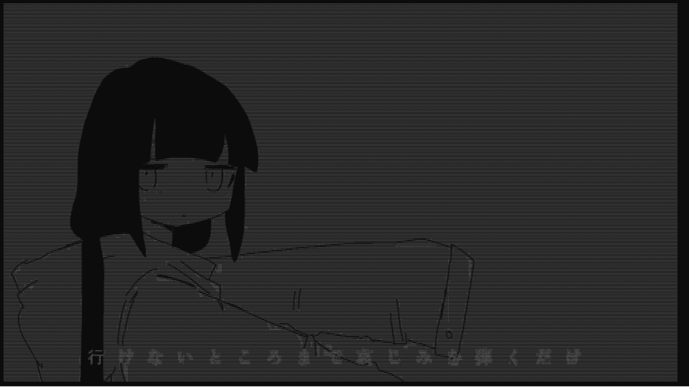

# Terminal ASCII Player

[Español](#español) · [English](#english)



---

## Español

Reproductor de videos en la terminal: cada frame se convierte a caracteres ASCII y se dibuja en la consola,
con el audio del video sincronizado. Viene con un video de ejemplo (*Bad Apple!!*) y puedes agregar
los tuyos.

### Características

- Reproduce cualquier video (`.mp4`, `.mkv`, `.avi`, `.mov`, `.webm`) como arte ASCII en la terminal.
- **Audio incluido**: se toma directamente del propio video, sin archivos de audio aparte.
- **Audio y video siempre sincronizados**: si la terminal no alcanza a dibujar a tiempo, se saltan frames
  en lugar de atrasarse.
- La imagen se adapta al tamaño de la terminal (también si la redimensionas durante la reproducción)
  y se centra, incluso con videos verticales.
- Funciona en Windows (Windows Terminal o CMD), Linux y macOS.

### Requisitos

- [Python](https://www.python.org/downloads/) 3.8 o superior. En Windows, marca la opción
  **"Add Python to PATH"** durante la instalación.
- Las librerías de [`requirements.txt`](requirements.txt): `opencv-python`, `numpy` y `ffpyplayer`.

### Instalación (paso a paso)

1. Descarga el proyecto: en GitHub, botón **Code → Download ZIP** (y descomprímelo), o clónalo con git:

   ```bash
   git clone https://github.com/LudwingJassir/Terminal-ASCII-Video-Player.git
   ```

2. Abre una terminal dentro de la carpeta del proyecto.
3. Instala las dependencias:

   ```bash
   pip install -r requirements.txt
   ```

### Cómo ejecutarlo

1. Inicia el reproductor:
   - **Windows:** doble clic en `run.bat`, o en la terminal:

     ```bash
     python main.py
     ```

   - **Linux / macOS:**

     ```bash
     sh run.sh
     ```

2. Aparece la lista de videos disponibles. Escribe el **número** del video y presiona Enter
   (o `q` para salir).
3. Disfruta. Para detener la reproducción en cualquier momento, presiona `Ctrl+C`.

### 💡 Para una mejor experiencia y calidad de imagen

Cada carácter de la terminal es un "píxel" de la imagen: **cuanto más pequeña sea la letra, más caracteres
entran y más nítido se ve el video**. Con el tamaño de letra normal la imagen se ve muy pixelada, así que
antes (o durante) la reproducción:

| Acción | Windows Terminal | CMD clásico |
|---|---|---|
| Achicar la letra (más nitidez) | `Ctrl` + `-` o `Ctrl` + rueda del mouse hacia abajo | `Ctrl` + rueda del mouse hacia abajo |
| Agrandar la letra | `Ctrl` + `+` o `Ctrl` + rueda del mouse hacia arriba | `Ctrl` + rueda del mouse hacia arriba |
| Volver al tamaño original | `Ctrl` + `0` | `Ctrl` + rueda hacia arriba |

Más consejos:

- **Maximiza la ventana** o pon la terminal en pantalla completa (`F11` en Windows Terminal).
- La imagen se reajusta sola al cambiar el tamaño de la letra o de la ventana, no hace falta reiniciar.
- Una letra muy pequeña le da más trabajo a la terminal; si notas que el video va a saltos,
  agranda un poco la letra. **Windows Terminal** dibuja mucho más rápido que el CMD clásico.

### Agregar tus propios videos

1. Copia tu video a la carpeta **`videos/`** del proyecto.
   - Formatos aceptados: `.mp4`, `.mkv`, `.avi`, `.mov`, `.webm`.
   - El audio se toma del mismo archivo.
   - El nombre del archivo (sin la extensión) es el que aparece en el menú, por ejemplo
     `videos/MiVideo.mp4` se muestra como `MiVideo`.
2. Ejecuta el reproductor como siempre y elige el número de tu video.

Notas:

- Si el video no tiene pista de audio, se reproduce igual, en silencio.
- Los videos con alto contraste (siluetas, blanco y negro, animaciones simples) son los que mejor se ven en ASCII.

#### Si un video no se reproduce: conviértelo con ffmpeg

Algunos archivos usan códecs que OpenCV no puede leer. La solución es convertirlos a un MP4 estándar con
[ffmpeg](https://ffmpeg.org/):

1. Instala ffmpeg:
   - **Windows:** `winget install Gyan.FFmpeg` (o descárgalo de [ffmpeg.org](https://ffmpeg.org/download.html))
   - **macOS:** `brew install ffmpeg`
   - **Linux (Debian/Ubuntu):** `sudo apt install ffmpeg`
2. Convierte el video y guárdalo directamente en `videos/`:

   ```bash
   ffmpeg -i mi_video.webm -c:v libx264 -c:a aac videos/mi_video.mp4
   ```

3. **Opcional:** como en ASCII no se necesita alta resolución, puedes reducirla para que el archivo pese
   menos y se decodifique más rápido:

   ```bash
   ffmpeg -i mi_video.mp4 -vf scale=-2:480 -c:v libx264 -c:a aac videos/mi_video_480p.mp4
   ```

### Estructura del proyecto

```
Terminal-ASCII-Video-Player/
├── main.py            # Programa principal: menú, conversión a ASCII, audio y sincronización
├── requirements.txt   # Dependencias de Python
├── run.bat            # Lanzador para Windows
├── run.sh             # Lanzador para Linux / macOS
├── videos/            # Videos disponibles en el menú (agrega aquí los tuyos)
├── assets/            # Imágenes del README
└── README.md
```

### Cómo funciona

1. **Menú:** `main.py` lista los videos de la carpeta `videos/` y te deja elegir uno.
2. **Audio:** `ffpyplayer` reproduce únicamente la pista de audio del video elegido.
3. **Video:** OpenCV lee los frames; cada uno se pasa a escala de grises y se reduce al tamaño de la terminal
   (respetando la proporción, ya que un carácter es aprox. el doble de alto que de ancho).
4. **ASCII:** cada nivel de gris se traduce a un carácter de la rampa ` .:-=+*#%@` (de oscuro a claro)
   usando numpy, y el frame completo se escribe de una sola vez en la terminal.
5. **Sincronización:** el audio es el reloj maestro. En cada momento se calcula qué frame corresponde a la
   posición actual del audio: si el video va atrasado se saltan frames, y si va adelantado se espera.
6. **Compensación de latencia:** la terminal tarda en pintar cada frame (más cuanto más pequeña es la letra,
   porque hay más caracteres). El programa mide ese tiempo mientras reproduce y dibuja por adelantado el
   frame que corresponderá cuando aparezca en pantalla, así la imagen sigue sincronizada con la música
   aunque achiques mucho la letra.

Si quieres experimentar, al inicio de `main.py` puedes cambiar `ASCII_RAMP` (los caracteres usados),
`CHAR_ASPECT` (la proporción alto/ancho de la letra de tu terminal) y `SYNC_OFFSET` (ajuste manual de la
sincronización en segundos: un valor positivo adelanta la imagen y uno negativo la retrasa).

### Problemas comunes

| Problema | Solución |
|---|---|
| `ModuleNotFoundError: No module named 'cv2'` (o `ffpyplayer`) | Ejecuta `pip install -r requirements.txt`. |
| `'python' no se reconoce como un comando` | Reinstala Python marcando "Add Python to PATH", o usa `py main.py`. |
| No aparece mi video en el menú | Revisa que esté dentro de `videos/` y que tenga una extensión aceptada. |
| El video no abre o sale un error | Conviértelo con ffmpeg (ver arriba). |
| La imagen se ve muy pixelada | Achica la letra de la terminal con `Ctrl` + `-` o `Ctrl` + rueda del mouse. |
| El video va a saltos | La terminal no alcanza a dibujar: agranda un poco la letra o usa Windows Terminal. |
| La música va detrás de la imagen (por ejemplo con audífonos Bluetooth) | Pon `SYNC_OFFSET` en negativo al inicio de `main.py`, por ejemplo `-0.2`. |

### Créditos

LudwingJassir y muchas repos de GitHub.

---

## English

Terminal video player: every frame is converted to ASCII characters and drawn in the console, with the
video's audio in sync. It ships with one sample video (*Bad Apple!!*) and you can add your own.

### Features

- Plays any video (`.mp4`, `.mkv`, `.avi`, `.mov`, `.webm`) as ASCII art in the terminal.
- **Audio included**: taken straight from the video file.
- **Audio and video always in sync**: if the terminal can't keep up, frames are skipped instead of lagging behind.
- The image fits the terminal size (even if you resize it while playing) and is centered, vertical videos included.
- Works on Windows (Windows Terminal or CMD), Linux and macOS.

### Requirements

- [Python](https://www.python.org/downloads/) 3.8 or newer. On Windows, check **"Add Python to PATH"** during install.
- The libraries in [`requirements.txt`](requirements.txt): `opencv-python`, `numpy` and `ffpyplayer`.

### Installation (step by step)

1. Get the project: on GitHub, **Code → Download ZIP** (and unzip it), or clone it with git:

   ```bash
   git clone https://github.com/LudwingJassir/Terminal-ASCII-Video-Player.git
   ```

2. Open a terminal inside the project folder.
3. Install the dependencies:

   ```bash
   pip install -r requirements.txt
   ```

### How to run

1. Start the player:
   - **Windows:** double-click `run.bat`, or in a terminal:

     ```bash
     python main.py
     ```

   - **Linux / macOS:**

     ```bash
     sh run.sh
     ```

2. The list of available videos shows up. Type the video's **number** and press Enter (or `q` to quit).
3. Enjoy. Press `Ctrl+C` at any time to stop playback.

### 💡 For the best experience and image quality

Every terminal character is one "pixel" of the image: **the smaller the font, the more characters fit and the
sharper the video looks**. At the default font size the image looks very blocky, so before (or while) playing:

| Action | Windows Terminal | Classic CMD |
|---|---|---|
| Smaller font (sharper image) | `Ctrl` + `-` or `Ctrl` + mouse wheel down | `Ctrl` + mouse wheel down |
| Bigger font | `Ctrl` + `+` or `Ctrl` + mouse wheel up | `Ctrl` + mouse wheel up |
| Reset to original size | `Ctrl` + `0` | `Ctrl` + mouse wheel up |

More tips:

- **Maximize the window** or go full screen (`F11` in Windows Terminal).
- The image re-fits automatically when you change the font or window size, no restart needed.
- A very small font means more work for the terminal; if playback gets choppy, make the font a bit bigger.
  **Windows Terminal** renders much faster than classic CMD.

### Adding your own videos

1. Copy your video into the project's **`videos/`** folder.
   - Supported formats: `.mp4`, `.mkv`, `.avi`, `.mov`, `.webm`.
   - Audio is read from the same file; you **don't** need a separate audio file.
   - The file name (without extension) is what shows in the menu, e.g. `videos/MyVideo.mp4` shows as `MyVideo`.
2. Run the player as usual and pick your video's number.

Notes:

- Videos without an audio track still play, just silently.
- High-contrast videos (silhouettes, black and white, simple animation) look best in ASCII.

#### If a video won't play: convert it with ffmpeg

Some files use codecs OpenCV can't read. Convert them to a standard MP4 with [ffmpeg](https://ffmpeg.org/):

1. Install ffmpeg:
   - **Windows:** `winget install Gyan.FFmpeg` (or download it from [ffmpeg.org](https://ffmpeg.org/download.html))
   - **macOS:** `brew install ffmpeg`
   - **Linux (Debian/Ubuntu):** `sudo apt install ffmpeg`
2. Convert the video and save it straight into `videos/`:

   ```bash
   ffmpeg -i my_video.webm -c:v libx264 -c:a aac videos/my_video.mp4
   ```

3. **Optional:** ASCII doesn't need high resolution, so you can scale it down for a smaller, faster-to-decode file:

   ```bash
   ffmpeg -i my_video.mp4 -vf scale=-2:480 -c:v libx264 -c:a aac videos/my_video_480p.mp4
   ```

### Project structure

```
Terminal-ASCII-Video-Player/
├── main.py            # Main program: menu, ASCII conversion, audio and sync
├── requirements.txt   # Python dependencies
├── run.bat            # Windows launcher
├── run.sh             # Linux / macOS launcher
├── videos/            # Videos listed in the menu (add yours here)
├── assets/            # README images
└── README.md
```

### How it works

1. **Menu:** `main.py` lists the videos in `videos/` and lets you pick one.
2. **Audio:** `ffpyplayer` plays only the audio track of the chosen video.
3. **Video:** OpenCV reads the frames; each one is converted to grayscale and scaled to the terminal size
   (keeping the aspect ratio, since a character is about twice as tall as it is wide).
4. **ASCII:** each gray level maps to a character in the ramp ` .:-=+*#%@` (dark to light) using numpy,
   and the whole frame is written to the terminal in one go.
5. **Sync:** audio is the master clock. At every moment the program works out which frame matches the current
   audio position: if the video is behind, frames are skipped; if it's ahead, it waits.
6. **Latency compensation:** the terminal takes time to paint each frame (longer with smaller fonts, since there
   are more characters). The program measures that time while playing and draws ahead the frame that will match
   the audio when it actually shows up, so the image stays in sync with the music even with a tiny font.

To experiment, change `ASCII_RAMP` (the characters used), `CHAR_ASPECT` (your terminal font's height/width
ratio) and `SYNC_OFFSET` (manual sync adjustment in seconds: positive shows the image earlier, negative later)
at the top of `main.py`.

### Troubleshooting

| Problem | Fix |
|---|---|
| `ModuleNotFoundError: No module named 'cv2'` (or `ffpyplayer`) | Run `pip install -r requirements.txt`. |
| `'python' is not recognized as a command` | Reinstall Python with "Add Python to PATH" checked, or use `py main.py`. |
| My video doesn't show up in the menu | Make sure it's inside `videos/` and has a supported extension. |
| The video won't open or throws an error | Convert it with ffmpeg (see above). |
| The image looks very blocky | Shrink the terminal font with `Ctrl` + `-` or `Ctrl` + mouse wheel. |
| Playback is choppy | The terminal can't keep up: make the font a bit bigger or use Windows Terminal. |
| The music lags behind the image (e.g. with Bluetooth headphones) | Set `SYNC_OFFSET` to a negative value at the top of `main.py`, e.g. `-0.2`. |

### Credits

LudwingJassir and many GitHub repos.
